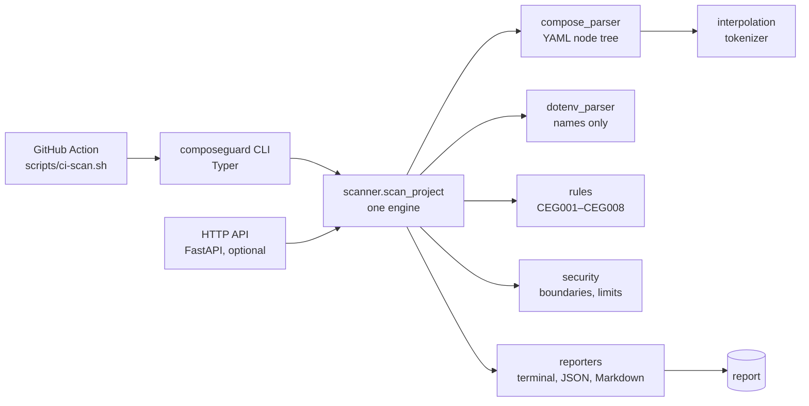

# ComposeEnvGuard

**Catch Docker Compose environment configuration mistakes before they break your deployment.**

ComposeEnvGuard reads your Compose files, your environment template (`.env.example` or `.env.sample`) and any env files you point it at. It reports variables that Compose needs but your template does not document, env files that are required but missing, duplicate template entries, and more. Every finding says where the problem is, how to fix it, and what it could not verify.

It is a **read-only, local** tool. It never runs your containers, never executes your code, never prints environment values, and never sends your files anywhere.

> Status: version 0.1.0, alpha. Not yet published to PyPI. See [Installation](#installation) for the supported ways to run it today.

## Quick start

```bash
# 1. Install from a clone of this repository
python -m pip install .

# 2. Scan your project (the directory that contains compose.yaml)
composeguard scan .

# 3. Machine-readable output for tools and CI
composeguard scan . --format json --output report.json
```

Exit codes: `0` no findings at or above the failure threshold, `1` threshold reached, `2` the input could not be analyzed.

## Who is it for?

- Developers who maintain a Docker Compose stack with an `.env.example` or `.env.sample` file.
- Teams who want a pull-request check that catches missing variable documentation before merge.
- Anyone new to Docker Compose who wants to understand which variables Compose actually uses.

## Why does it exist?

Compose files mix three different things that look alike:

| Syntax | What it means |
| --- | --- |
| `image: myapp:${IMAGE_TAG}` | Compose reads `IMAGE_TAG` to build the configuration. The variable is **not** passed into your container. |
| `environment: DATABASE_URL: ${DATABASE_URL}` | Compose reads `DATABASE_URL` and **puts it into the container**. |
| `env_file: ./config/api.env` | Compose loads **every variable in that file** into the container. |

A missing variable often fails quietly, or only in production. ComposeEnvGuard checks these relationships statically, before deployment, and tells you what it is and is not sure about.

## What it detects

| ID | Severity | Detects |
| --- | --- | --- |
| CEG001 | warning | A Compose value references a variable that the template does not document. |
| CEG002 | warning | The same variable is declared twice in the template. |
| CEG003 | error | A required `env_file` does not exist. |
| CEG004 | info | A template variable is not used by the analyzed Compose files. |
| CEG005 | error / warning / info | Invalid YAML, unsupported constructs, unreadable or oversized files, out-of-boundary paths. |
| CEG006 | error / warning | A service contract (`.composeguard.yaml`) requires a variable the service does not declare. |
| CEG007 | info | An env file was not read under the privacy policy, so its variables could not be verified. |
| CEG008 | warning / error | Empty or invalid variable names, non-scalar values, duplicate service entries. |

Full descriptions, examples and the uncertainty notes are in [docs/rules.md](docs/rules.md). `composeguard rules` prints the same list.

## What it intentionally does not detect

- **Whether a variable is actually set at runtime.** A variable missing from your template may come from your shell, CI secrets, or a file the scanner does not read. ComposeEnvGuard reports it as "not documented" (a warning), never as "missing at runtime".
- **Secret values, or whether they are correct.** Values are never read by default and never printed.
- **Full Compose schema validation.** Use `docker compose config` for that. ComposeEnvGuard focuses on environment configuration.
- **How your application code uses variables.** A template variable that is only read in code shows as "possibly unused" (info), with that caveat.
- **Compose override merge semantics**, `extends` and `include` across files. These are reported as unsupported. See [docs/limitations.md](docs/limitations.md).

## Example output

Real output from `composeguard scan examples/broken-project`:

```text
ComposeEnvGuard

Project: broken-project
Files analyzed: 2
Services analyzed: 2

Results:

[WARNING] CEG001 — JWT_SECRET
  Undocumented interpolation reference
  Referenced in compose.yaml but not documented in .env.sample (service: api).
  Location: compose.yaml:13 (service: api)
  Suggestion: Document JWT_SECRET in .env.sample, or list it under external_variables in .composeguard.yaml if it is supplied externally.
  Uncertainty: It may be supplied by the shell, CI secrets, or an environment file that was not read; this does not prove it is missing at runtime.

[WARNING] CEG002 — LOG_LEVEL
  Duplicate template variable
  LOG_LEVEL is declared more than once in .env.sample (first at line 3).
  Location: .env.sample:4
  Suggestion: Keep a single declaration for each variable in the template.

[ERROR] CEG003 — config/missing.env
  Missing required env_file
  The api service references a required environment file that does not exist: config/missing.env.
  Location: compose.yaml:10 (service: api)
  Suggestion: Create the expected file, correct its path, or mark it 'required: false' when it is optional.

[INFO] CEG004 — LEGACY_API_URL
  Potentially unused documented variable
  Documented in .env.sample but not referenced in the analyzed Compose files.
  Location: .env.sample:5
  Suggestion: Check whether the application still needs this variable and remove it from the template if not.
  Uncertainty: Application code may still read it directly.

Summary:
Errors: 1
Warnings: 2
Information: 1

Final status: Failed
```

The healthy example, `composeguard scan examples/healthy-project`, reports `Final status: Passed` with no findings.

## Installation

### Python dependencies

ComposeEnvGuard needs **Python 3.11 or newer**. Check with `python --version` (Windows: `py --version`).

Installing the package installs its dependencies automatically:

| Package | Why |
| --- | --- |
| typer, rich | the command line and coloured terminal output |
| pydantic | the report data models |
| PyYAML | reads Compose files safely |
| python-dotenv | parses environment templates (names only) |

The optional HTTP API adds `fastapi` and `uvicorn`, installed with the `api` extra (`".[api]"`). You do not need it to scan files.

### Option A: Python (local checkout)

Requires Python 3.11 or newer.

```bash
git clone https://github.com/MEGZE-0/ENV-GUARD.git
cd ENV-GUARD
python -m pip install .
composeguard version
```

To keep it isolated in a virtual environment:

```bash
# Linux / macOS
python3 -m venv .venv
. .venv/bin/activate
python -m pip install .
composeguard scan examples/healthy-project
```

```powershell
# Windows PowerShell
py -m venv .venv
.\.venv\Scripts\Activate.ps1
python -m pip install .
composeguard scan examples\healthy-project
```

If PowerShell blocks the activation script, run `Set-ExecutionPolicy -Scope CurrentUser RemoteSigned` once, or skip activation and call `.\.venv\Scripts\composeguard.exe` directly.

For the optional HTTP API, install the `api` extra: `python -m pip install ".[api]"`.

Installing from PyPI is **not available yet**: the package has not been published. The publication checklist is in [docs/publishing.md](docs/publishing.md).

### Option B: Docker CLI

Build the image once from the repository root:

```bash
docker build -t compose-env-guard .
```

Scan a project. The project directory is mounted **read-only**, and the container needs no network, database, Docker socket or privileges to scan:

```bash
# Linux / macOS
docker run --rm -v "$PWD:/workspace:ro" compose-env-guard scan /workspace
```

```powershell
# Windows PowerShell
docker run --rm -v "${PWD}:/workspace:ro" compose-env-guard scan /workspace
```

### Option C: HTTP API with Docker Compose

```bash
docker compose up --build -d
# then visit http://localhost:8000/docs in your browser
docker compose down
```

The port is published on `127.0.0.1` only, so it is reachable from your own machine and not from your network. See [docs/api.md](docs/api.md) before exposing it anywhere.

## Verification status

What has actually been run, and what has not. Read this before relying on an instruction.

| Instruction | Status |
| --- | --- |
| `python -m pip install .` from a clone, then `composeguard scan`, `version`, `rules` | Verified in a clean virtual environment on Linux (development sandbox) and in CI on Ubuntu for Python 3.11–3.13 |
| Scanning the examples: healthy passes (exit 0), broken fails (exit 1) | Verified (local Linux, CI) |
| `composeguard serve` and the `/health`, `/api/v1/rules`, `/api/v1/scan`, `/docs` endpoints | Verified locally on Linux |
| `docker build`, `docker run … scan` (Linux/macOS form), non-root user, healthy/broken exit codes | Verified in CI on a real Docker daemon (GitHub Actions, Ubuntu 24.04; run 40311468211) |
| `docker compose up --build -d`, `/health`, `/docs`, `/api/v1/scan`, port published on `127.0.0.1` only, `docker compose down` | Verified in CI on a real Docker daemon (GitHub Actions, Ubuntu 24.04). Not run on your own machine |
| Windows PowerShell commands (`py -m venv`, activation, `docker run … ${PWD}`) | Written for PowerShell; **not executed** on Windows |
| macOS commands | Standard Python and Docker commands, same as Linux; **not executed** on macOS |
| Install from PyPI | **Not available**: the package is not published |

## First scan: step by step

1. Go to the directory that contains your `compose.yaml` (or `docker-compose.yml`).
2. Run `composeguard scan .`.
3. For each finding, read the **Suggestion** line. If a variable is supplied externally, either document it in your template or add it to `external_variables` in `.composeguard.yaml`.
4. Re-run the scan. The default threshold fails only on errors. Use `--fail-on warning` to make warnings fail too.

If no Compose file is found, the scan stops with exit code `2` and tells you how to point it at one, using `--compose PATH`.

## CLI reference

```text
composeguard scan [PATH]
    --format terminal|json|markdown   output format (default: terminal)
    --output FILE                     write the report to FILE
    --fail-on error|warning|info|never   failure threshold (default: error)
    --env-example FILE                template relative to the project
    --compose FILE                    Compose file, repeatable (for overrides and nested projects)
    --config FILE                     configuration file (default: .composeguard.yaml)
    --include-env-file FILE           read variable NAMES from this file; values are discarded (repeatable)

composeguard rules [--format terminal|json]
composeguard version
composeguard serve [--host 127.0.0.1] [--port 8000]   optional HTTP API (needs the api extra)
```

Examples:

```bash
composeguard scan ./my-project
composeguard scan . --format json
composeguard scan . --format markdown
composeguard scan . --output report.json --format json
composeguard scan . --fail-on warning
composeguard scan . --env-example .env.sample
composeguard scan . --compose compose.yaml --compose compose.prod.yaml
composeguard scan . --include-env-file .env          # verify names in a private file
```

Colour is used when the terminal supports it. Set `NO_COLOR=1` to disable it. Every severity also has a text label, so colour is never the only signal.

## Configuration: `.composeguard.yaml` (optional)

```yaml
version: 1
disabled_rules: [CEG004]              # rules to turn off
severity_overrides: {CEG001: error}   # change the severity of a rule
external_variables: [CI_TOKEN]        # acknowledged as supplied externally (no CEG001)
services:                             # explicit contracts (CEG006)
  api:
    required_env: [DATABASE_URL, JWT_SECRET]
```

Unknown keys are rejected so typos do not silently disable checks.

## Privacy and security

- **Read-only.** The scanner never writes to your project and never starts processes.
- **No values.** Environment values are never printed, stored or put in reports, including in error messages. Reports contain variable names, paths, line numbers and fixed messages.
- **Private files stay private.** `.env`, `.env.local`, `.env.production` and other env files that are not templates are **not read**. They are listed as unverified (CEG007). To verify their variable names, pass `--include-env-file`. Values are discarded immediately.
- **Boundaries.** Paths must stay inside the project. Traversal and symlinks that point outside are refused and never followed.
- **Limits.** Compose files up to 1 MiB, env files up to 256 KiB, configuration up to 64 KiB, and at most 10 Compose files per scan.
- **No telemetry, no network calls, no accounts.** Scanning works fully offline.
- **Safe parsing.** YAML is parsed with `yaml.SafeLoader`. No YAML-defined commands are run and no shell is invoked by the scanner.

Read [SECURITY.md](SECURITY.md) for the threat model and how to report a vulnerability.

## Reports

- **Terminal**: human-readable, described above.
- **JSON**: versioned (`schema_version`), stable ordering, documented in [docs/json-report.md](docs/json-report.md) with a JSON Schema at [docs/report.schema.json](docs/report.schema.json).
- **Markdown**: tables for findings, files and services; suitable for pull-request comments or the GitHub job summary.

## HTTP API

```bash
composeguard serve                      # localhost:8000 by default
curl -s http://127.0.0.1:8000/health
curl -s -X POST http://127.0.0.1:8000/api/v1/scan \
  -H 'Content-Type: application/json' \
  -d '{"files": {"compose.yaml": "services:\n  api:\n    image: x:${TAG}\n", ".env.example": "A=1\n"}}'
```

Endpoints: `GET /health`, `GET /api/v1/rules`, `POST /api/v1/scan`, and the interactive `GET /docs`. The API accepts file **contents** for a fixed set of file names, never host paths, and stores nothing. Full details, status codes and limits are in [docs/api.md](docs/api.md).

## GitHub Actions

ComposeEnvGuard ships a composite action (`action.yml`) that writes the Markdown report to the job summary and fails only when your chosen threshold is reached. Example workflow, input reference and runner requirements are in [docs/github-action.md](docs/github-action.md).

## How it differs from `.env` checkers

Generic `.env` consistency tools compare two env files with each other, for example `.env` against `.env.example`. ComposeEnvGuard is about **Compose**:

- It reads the Compose YAML and understands interpolation (`${VAR:-default}`, `$$` escapes, nested defaults), `environment` (mapping and list forms), and `env_file` (short and long forms, `required`).
- It separates interpolation from container environment, so it can tell you a variable is used to build the configuration but never reaches your app.
- It reports what the scanner cannot verify, instead of guessing.
- It never needs your real `.env` values.

## Architecture



More detail is in [docs/architecture.md](docs/architecture.md).

## Examples

- [examples/healthy-project](examples/healthy-project): passes with no errors. `composeguard scan examples/healthy-project`
- [examples/broken-project](examples/broken-project): deliberate problems. `composeguard scan examples/broken-project`

## Contributing and bug reports

- Read [CONTRIBUTING.md](CONTRIBUTING.md) for the development setup, test and lint commands, and the rules for adding a check.
- Report bugs with the bug-report template: https://github.com/MEGZE-0/ENV-GUARD/issues/new/choose
- Report security issues privately, as described in [SECURITY.md](SECURITY.md).
- Roadmap: [ROADMAP.md](ROADMAP.md). Changes: [CHANGELOG.md](CHANGELOG.md).

## License

MIT. See [LICENSE](LICENSE).
