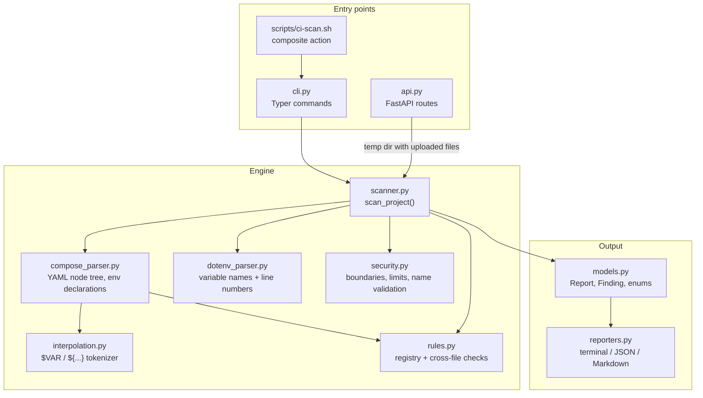

# Architecture

ComposeEnvGuard has one scanning engine. The CLI, the HTTP API and the GitHub Action all call it. The engine has no dependency on Typer or FastAPI, so it can be tested directly.

## Pipeline

1. **Configuration.** `.composeguard.yaml` (or `--config`) is read and validated with Pydantic. Unknown keys are errors.
2. **Compose files.** Each selected file is read inside the project boundary, parsed with `yaml.compose` (node tree, not constructed objects) and turned into facts: services, `environment` names, `env_file` entries, and every interpolation reference with its line number.
3. **Template.** The environment template is parsed for names and line numbers. Values are discarded.
4. **env_file resolution.** Each `env_file` path is resolved relative to its Compose file and checked against the project boundary. Only templates and explicitly included files are read. Everything else is reported as unverified.
5. **Rules.** Syntax-level findings come from the parsers. Cross-file findings (CEG001–CEG004, CEG006, CEG007) come from `rules.analyze_project`.
6. **Post-processing.** Disabled rules are removed, severity overrides are applied, duplicates collapse, and findings are sorted by rule, file, line, variable and service. The same input always gives the same output.
7. **Report.** Counts, the fail threshold and the status are computed. Reporters only format this data.

## Design decisions

- **Node-based YAML.** Constructing Python objects would lose line numbers and would merge anchors silently. Walking the node tree keeps locations and lets the parser report duplicate keys, which the safe constructor would silently overwrite.
- **Tokenizer for interpolation.** A single regular expression cannot handle `$$` escapes and nested defaults correctly. The tokenizer is about 150 lines and is tested for each operator.
- **Names, not values.** The dotenv parser and the Compose parser keep only names and line numbers. Messages are fixed strings plus names that pass a validity check. Anything else is replaced with `<invalid name>`.
- **Privacy by default.** `security.py` decides which files may be read. The rules only see what the scanner was allowed to read, and CEG007 reports what it was not allowed to read.
- **API by temporary directory.** The API writes uploaded contents into a private temporary directory and calls the same engine, with `verify_existence=False`. That keeps one code path. The directory is deleted when the request ends.

## Adding a rule

1. Add a `RuleSpec` to `RULES` in `rules.py` with a new, unused ID.
2. Emit findings with `make_finding(...)`, either from a parser (syntax) or from `analyze_project` (cross-file).
3. Add positive and negative tests in `tests/test_scanner.py` or a new module.
4. Document it in `docs/rules.md`. The test suite checks that every rule is documented.
5. Add a CHANGELOG entry.
